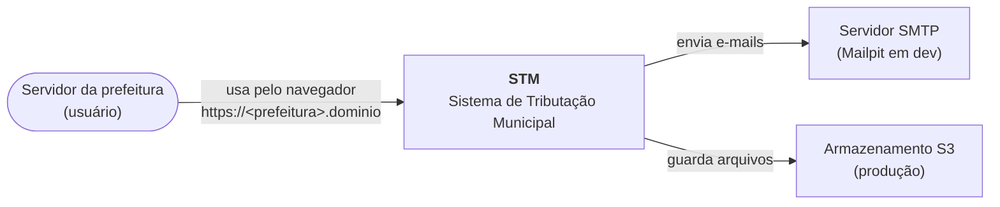
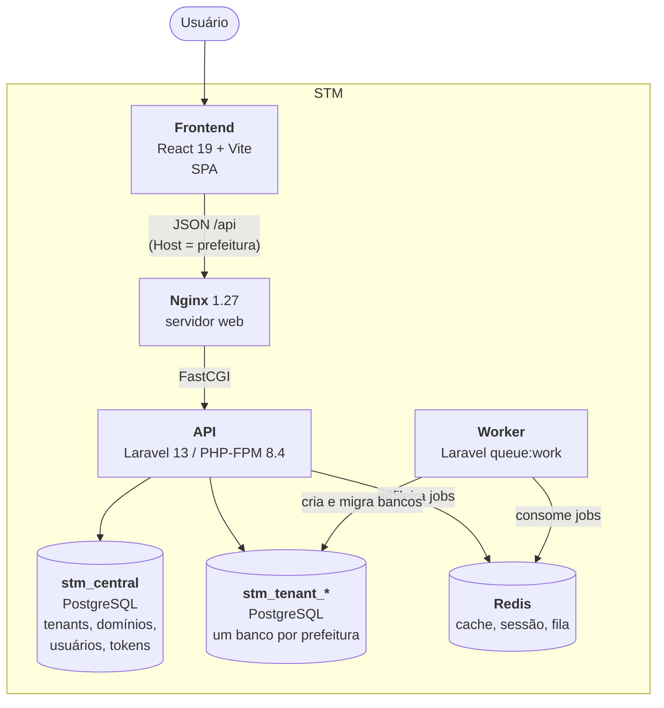
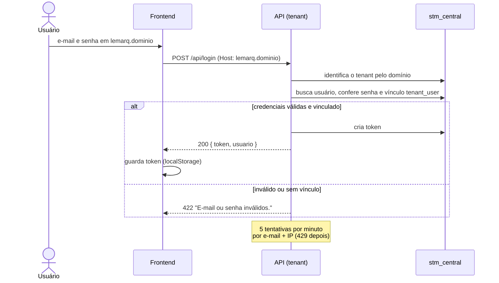
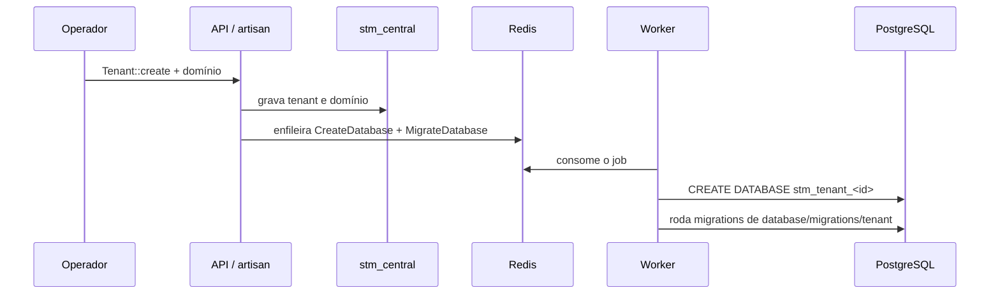
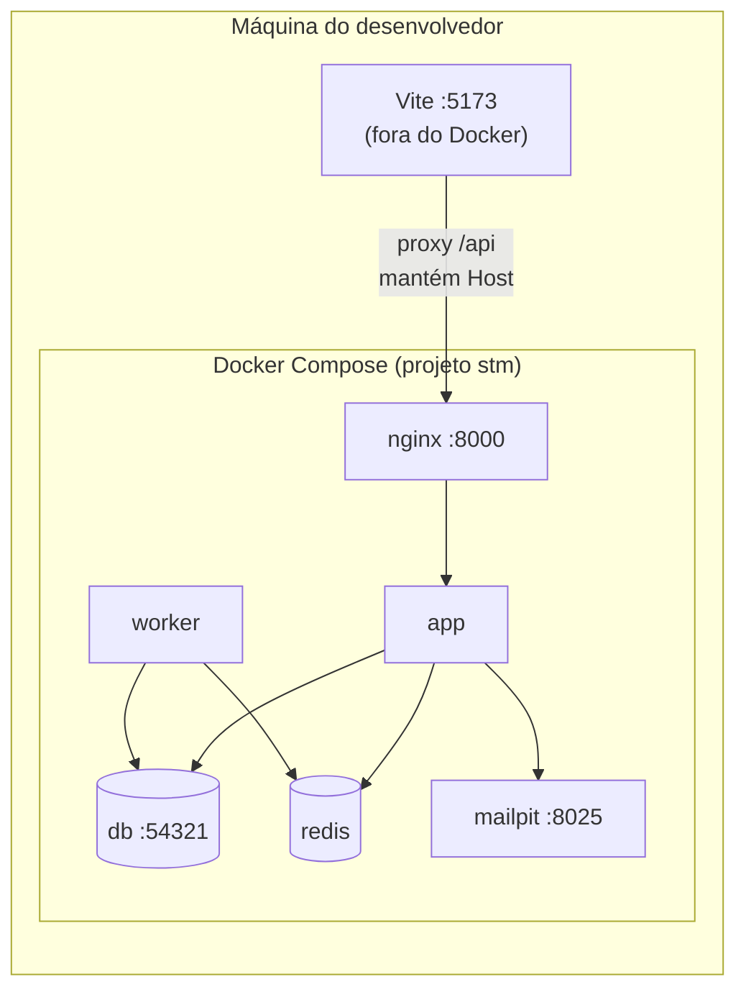

# Arquitetura do STM

Documento no modelo [arc42](https://arc42.org/overview), com diagramas no [modelo C4](https://c4model.com/) escritos em Mermaid. As decisões citadas estão detalhadas em [ADRs](../adr/).

## 1. Introdução e objetivos

O STM (Sistema de Tributação Municipal) é um sistema SaaS usado por várias prefeituras. Cada prefeitura é um **tenant**: tem subdomínio e banco de dados próprios. Os usuários são cadastrados uma única vez e podem ter acesso a uma ou mais prefeituras.

### Objetivos de qualidade

| Prioridade | Objetivo | Cenário |
| --- | --- | --- |
| 1 | **Isolamento dos dados** | Dados de uma prefeitura nunca aparecem em outra, nem por erro de consulta. |
| 2 | **Segurança de acesso** | Um usuário só entra nas prefeituras a que está vinculado; tokens revogados param de funcionar na hora. |
| 3 | **Manutenibilidade** | Um desenvolvedor novo sobe o ambiente com poucos comandos; CI barra código fora do padrão. |
| 4 | **Provisionamento simples** | Criar uma prefeitura nova não exige passos manuais no banco. |

### Partes interessadas

| Papel | Expectativa |
| --- | --- |
| Servidores da prefeitura | Acessar o sistema pelo endereço da sua prefeitura e trabalhar apenas com os dados dela. |
| Equipe de desenvolvimento (Lemarq Software) | Código previsível, testes rápidos, ambiente reproduzível. |
| Operação | Deploy automatizado e seguro, sem publicar código que falhou no CI. |

## 2. Restrições

| Restrição | Descrição |
| --- | --- |
| PHP 8.4 | Dev, CI e produção rodam 8.4 (`composer.json` aceita `^8.3`). |
| Laravel 13, somente API | O backend não renderiza páginas; o frontend é uma SPA separada. |
| PostgreSQL 17 | Banco de dados em todos os ambientes, exceto testes (SQLite) ([ADR-0007](../adr/0007-postgresql.md)). |
| Node 22 | Versão do frontend no CI. |
| Frontend fora do Docker | Em desenvolvimento, o frontend roda direto na máquina ([ADR-0005](../adr/0005-frontend-fora-do-docker.md)). |
| Deploy bare-metal | Produção roda em servidor próprio, publicado por SSH, sem contêineres. |

## 3. Contexto e escopo

### Diagrama de contexto (C4 — nível 1)

| Parceiro | Interface |
| --- | --- |
| Navegador do usuário | HTTPS; SPA React consumindo a API JSON. |
| SMTP | Envio de e-mails (Mailpit em desenvolvimento). |
| S3 | Arquivos em produção via `league/flysystem-aws-s3-v3`; disco local em desenvolvimento. |

## 4. Estratégia de solução

| Problema | Solução | Decisão |
| --- | --- | --- |
| Várias prefeituras, dados isolados | Multi-tenancy com **um banco por prefeitura**, identificada pelo subdomínio (`stancl/tenancy`) | [ADR-0002](../adr/0002-multi-tenancy-banco-por-prefeitura.md) |
| Mesmo usuário em várias prefeituras | Usuários e tokens **centralizados** no `stm_central`, com vínculo explícito usuário ↔ prefeitura | [ADR-0003](../adr/0003-usuarios-centralizados.md) |
| Autenticação da SPA | **Tokens de API do Sanctum** (Bearer) | [ADR-0004](../adr/0004-autenticacao-por-token.md) |
| Separar front e back | **Monorepo** com API Laravel e SPA React | [ADR-0001](../adr/0001-monorepo-laravel-react.md) |
| Criar banco do tenant sem travar a requisição | Provisionamento **assíncrono** em fila (Redis + worker) | [ADR-0002](../adr/0002-multi-tenancy-banco-por-prefeitura.md) |
| Testes rápidos e seguros | Testes em **SQLite**, com trava contra rodar no banco real | [ADR-0006](../adr/0006-testes-em-sqlite.md) |

## 5. Visão de blocos

### Diagrama de contêineres (C4 — nível 2)

### Blocos do backend (C4 — nível 3)

| Bloco | Local | Responsabilidade |
| --- | --- | --- |
| Rotas centrais | `backend/routes/api.php` | Rotas acessíveis só pelos domínios centrais (`CENTRAL_DOMAINS`), ex.: `/api/status`. |
| Rotas de tenant | `backend/routes/tenant.php` | Rotas que inicializam o tenant pelo domínio: `/api/tenant`, `/api/login`, `/api/me`, `/api/logout`. |
| `AuthController` | `app/Http/Controllers` | Login, usuário atual e logout. |
| `EnsureUserBelongsToTenant` | `app/Http/Middleware` | Recusa (403) usuário autenticado sem vínculo com a prefeitura atual. |
| `Tenant` | `app/Models` | Prefeitura; tem domínios, banco próprio e usuários vinculados. |
| `User`, `PersonalAccessToken` | `app/Models` | Sempre na conexão central (`CentralConnection`). |
| `TenancyServiceProvider` | `app/Providers` | Eventos do tenancy: criação (em fila) e exclusão do banco do tenant. |
| `usuarios:criar` | `app/Console/Commands` | Cria usuário e vincula a prefeituras. |
| Relatórios | `app/Relatorios/` | Camada própria de relatórios (PDF via mPDF). *A construir.* |

### Blocos do frontend

| Bloco | Local | Responsabilidade |
| --- | --- | --- |
| Cliente HTTP | `src/lib/api.ts` | Axios com base `/api`, envia o token e trata 401 (sessão expirada). |
| Autenticação | `src/lib/auth.ts` | Hooks `useUsuario`, `useLogin`, `useLogout`. |
| Prefeitura | `src/lib/prefeitura.ts` | Descobre a prefeitura pelo endereço (`VITE_CENTRAL_DOMAIN`) e consulta `/api/tenant`. |
| Menu | `src/lib/navegacao.ts` | Módulos e telas do sistema. Fonte única do menu lateral, das rotas e do breadcrumb. Todo item tem `icone` (lucide-react). Um item com `paginas` vira submenu, e submenus podem ter outros submenus dentro. |
| `App` | `src/App.tsx` | Sem prefeitura no endereço (ou prefeitura inexistente) → landing page; senão, rotas do sistema. |
| `AppLayout` | `src/components` | Layout do sistema no modelo `sidebar-07` do shadcn: seletor de prefeitura, menu de módulos, menu do usuário, breadcrumb. |
| `RotaProtegida` | `src/components` | Redireciona para `/login` sem sessão válida. |
| Páginas | `src/pages` | `Landing`, `Login`, `Inicio`, `EmConstrucao` (telas do menu ainda não implementadas). |
| Componentes de UI | `src/components/ui` | shadcn/ui sobre Radix, gerados pelo CLI. |
| Gráficos | `src/components/graficos` | Gráficos em SVG próprio, sem biblioteca. *A construir.* |

## 6. Visão de tempo de execução

### Login em uma prefeitura

### Requisição autenticada

1. O frontend envia `Authorization: Bearer <token>`.
2. `InitializeTenancyByDomain` identifica a prefeitura pelo `Host` e troca a conexão padrão para o banco dela.
3. O Sanctum valida o token no `stm_central`.
4. `EnsureUserBelongsToTenant` confere o vínculo; sem vínculo → 403.
5. Resposta 401 faz o frontend apagar o token e voltar para `/login`.

### Criação de uma prefeitura

## 7. Visão de implantação

### Desenvolvimento

Todas as portas são publicadas apenas em `127.0.0.1`. Detalhes em [Serviços Docker](../referencia/servicos-docker.md).

### Produção

Servidor próprio (bare-metal), sem Docker. O workflow `deploy.yml` roda o CI completo e, se passar, entra por SSH e executa `composer install --no-dev`, migrations (central e tenants), `optimize`, build do frontend e recarrega o `php8.4-fpm`. Veja [Publicar em produção](../guias/deploy.md).

## 8. Conceitos transversais

### Multi-tenancy

- **Identificação:** pelo domínio da requisição (`Host`). Domínios em `CENTRAL_DOMAINS` são centrais; os demais são procurados na tabela `domains`.
- **Nome do banco:** `stm_tenant_` + id do tenant (ex.: `stm_tenant_prefeitura_teste`). O nome fica gravado em `tenants.data.tenancy_db_name`.
- **Migrations:** as do banco central ficam em `database/migrations/`; as de tenant em `database/migrations/tenant/`.
- **O que fica onde:**

| Banco | Tabelas |
| --- | --- |
| `stm_central` | `tenants`, `domains`, `tenant_user`, `users`, `personal_access_tokens`, `password_reset_tokens`, `sessions`, `cache`, `jobs`, tabelas de permissão |
| `stm_tenant_*` | tabelas de permissão (`roles`, `permissions`, …) e, futuramente, os dados tributários da prefeitura |

### Segurança

- Senhas com bcrypt (`password` com cast `hashed`).
- Tokens do Sanctum guardados como hash no `stm_central`; logout apaga o token.
- Limite de 5 tentativas de login por minuto por e-mail + IP.
- Vínculo usuário ↔ prefeitura checado no login e em toda rota autenticada.
- HTML vindo do editor rico deve passar pelo `mews/purifier` antes de ser salvo.
- Serviços de desenvolvimento publicados só em loopback.

### Papéis e permissões

`spatie/laravel-permission`, com as tabelas **no banco de cada prefeitura**: o mesmo usuário pode ter papéis diferentes em cada uma.

### Idioma

Interface, mensagens de erro e documentação em português do Brasil (`APP_LOCALE=pt_BR`).

### Qualidade de código

- Backend: Laravel Pint (checado no CI com `--test`), PHPUnit.
- Frontend: `tsc -b`, ESLint, Prettier (`format:check`), Vitest.

## 9. Decisões de arquitetura

Registradas como ADRs no formato MADR em [docs/adr](../adr/).

## 10. Requisitos de qualidade

| Atributo | Cenário | Como é verificado |
| --- | --- | --- |
| Isolamento | Usuário da prefeitura A usa seu token na prefeitura B, sem vínculo → 403 | `AuthTest::test_token_de_um_tenant_nao_acessa_tenant_sem_vinculo` |
| Segurança | 6ª tentativa de login em 1 minuto → 429 | `AuthTest::test_login_e_limitado_apos_cinco_tentativas` |
| Segurança | Token após logout → 401 | `AuthTest::test_logout_revoga_o_token` |
| Manutenibilidade | PR com código fora do padrão ou teste quebrado não entra na `main` | `ci.yml` |
| Operação | Deploy só publica com CI verde | `deploy.yml` (`needs: ci`) |

## 11. Riscos e dívidas técnicas

| Item | Impacto | Ação sugerida |
| --- | --- | --- |
| Deploy faz `git reset --hard` no servidor | Alterações manuais no servidor são perdidas | Nunca editar código direto no servidor. |
| Credenciais de dev fracas (`root`/`secret`) | Nenhum em dev; grave se copiadas para produção | Usar usuário próprio e senha forte em produção. |
| Token no `localStorage` | Exposto se houver XSS no frontend | Manter sanitização (`mews/purifier`) e não usar `dangerouslySetInnerHTML` sem sanitizar. |
| Recuperação de senha não implementada | Usuário depende do operador para trocar a senha | Implementar fluxo de "esqueci minha senha". |
| Login de peticionante não implementado | Previsto no levantamento de tecnologias | Definir modelo e fluxo. |
| Sem limpeza de tokens antigos | Tabela `personal_access_tokens` cresce | Definir expiração (`sanctum.expiration`) e agendar `sanctum:prune-expired`. |

## 12. Glossário

| Termo | Significado |
| --- | --- |
| **Tenant** | Uma prefeitura cliente, com banco e subdomínio próprios. |
| **Banco central** (`stm_central`) | Banco com tenants, domínios, usuários e tokens. |
| **Banco do tenant** (`stm_tenant_<id>`) | Banco exclusivo de uma prefeitura. |
| **Domínio central** | Endereço que não pertence a nenhuma prefeitura (ex.: `localhost`). |
| **Vínculo** (`tenant_user`) | Registro que dá a um usuário acesso a uma prefeitura. |
| **Provisionamento** | Criação e migração do banco de uma prefeitura nova, feita pelo worker. |
| **Peticionante** | Pessoa externa que faz pedidos à prefeitura (a implementar). |
| **ADR** | Architecture Decision Record — registro de uma decisão de arquitetura. |
